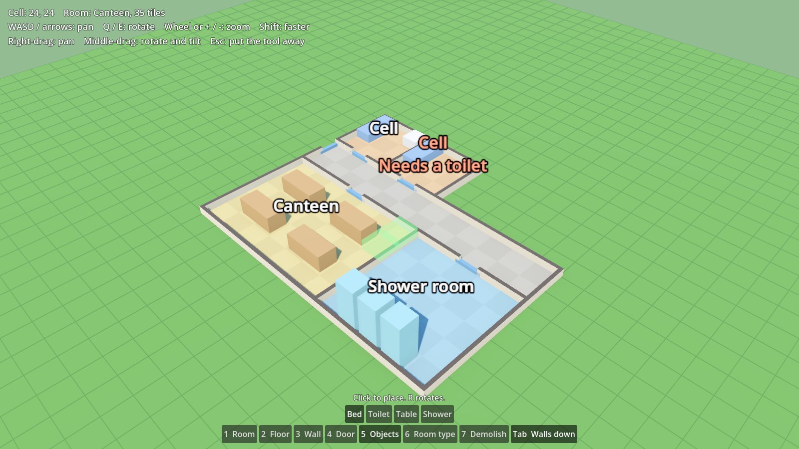

# Cosy Sims

A series of small, cute management sims that share one look and one set of
familiar mechanics. First up is a prison game, drawing on Prison Architect for
its systems, Parkitect for its camera and style, and The Sims / Software Inc.
for flexible building. Later games might include a hospital, an airport, a
school and a museum.



All art is placeholder for now. Built with [Godot 4.7](https://godotengine.org/).

## Getting started

1. Install Godot 4.7 (the standard build, not .NET).
2. Open Godot, choose **Import**, and pick this folder's `project.godot`.
3. Press **F5** to run. You start with a small sample prison you can fly
   around and build on.

### Controls

| Camera | |
| --- | --- |
| WASD or arrows | Pan |
| Q / E | Rotate |
| Mouse wheel or + / - | Zoom |
| Shift | Go faster |
| Right-drag | Pan |
| Middle-drag | Rotate and tilt |

| Building | |
| --- | --- |
| 1 Room | Drag to build a floor with walls all round |
| 2 Floor | Drag to lay floor |
| 3 Wall | Drag from corner to corner |
| 4 Door | Click a wall to make it a door, or a door to make it a wall |
| 5 Objects | Click to place; R rotates |
| 6 Room type | Click a room to mark it as a cell, canteen and so on |
| 7 Demolish | Click an object to remove it, or drag to clear an area |
| Tab | Walls up or cut away |
| Esc | Put the tool away |

Rooms are worked out from the walls automatically. Once a room has a type, a
label floats over it saying what it still needs, such as a toilet.

## Layout

| Path | What |
| --- | --- |
| `core/` | Parts every game will share: camera, grid, input. Kept free of prison-specific code. |
| `games/prison/` | The prison game. Anything specific to prisons lives here. |
| `tests/` | Headless checks (see below). |
| `tools/` | Developer helpers, such as the screenshot script. |
| `docs/` | The plan and design notes. |

The rule of thumb: build things in `games/prison/` first, and move them into
`core/` once they work and we can see what is genuinely generic. See
[docs/plan.md](docs/plan.md).

## Checks

```sh
godot --headless --import --path .          # once, to build the class cache
godot --headless --path . -s res://tests/test_runner.gd
```

To save a screenshot of the main scene (needs a display, not `--headless`;
on a machine without a GPU, `xvfb-run` with Mesa's lavapipe Vulkan driver
works):

```sh
godot --path . -s res://tools/screenshot.gd -- screenshot.png
```
