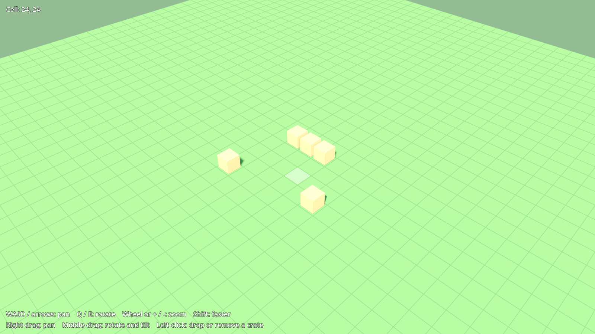

# Cosy Sims

A series of small, cute management sims that share one look and one set of
familiar mechanics. First up is a prison game, drawing on Prison Architect for
its systems, Parkitect for its camera and style, and The Sims / Software Inc.
for flexible building. Later games might include a hospital, an airport, a
school and a museum.



All art is placeholder for now. Built with [Godot 4.7](https://godotengine.org/).

## Getting started

1. Install Godot 4.7 (the standard build, not .NET).
2. Open Godot, choose **Import**, and pick this folder's `project.godot`.
3. Press **F5** to run. You should see a grassy grid you can fly around.

Controls: WASD or arrows to pan, Q/E to rotate, mouse wheel or +/- to zoom,
Shift to go faster, right-drag to pan, middle-drag to rotate and tilt, and
left-click to drop or remove a crate.

## Layout

| Path | What |
| --- | --- |
| `core/` | Parts every game will share: camera, grid, input. Kept free of prison-specific code. |
| `games/prison/` | The prison game. Anything specific to prisons lives here. |
| `tests/` | Headless checks (see below). |
| `tools/` | Developer helpers, such as the screenshot script. |
| `docs/` | The plan and design notes. |

The rule of thumb: build things in `games/prison/` first, and move them into
`core/` once they work and we can see what is genuinely generic. See
[docs/plan.md](docs/plan.md).

## Checks

```sh
godot --headless --import --path .          # once, to build the class cache
godot --headless --path . -s res://tests/test_runner.gd
```

To save a screenshot of the main scene (needs a display, not `--headless`):

```sh
godot --path . -s res://tools/screenshot.gd -- screenshot.png
```
