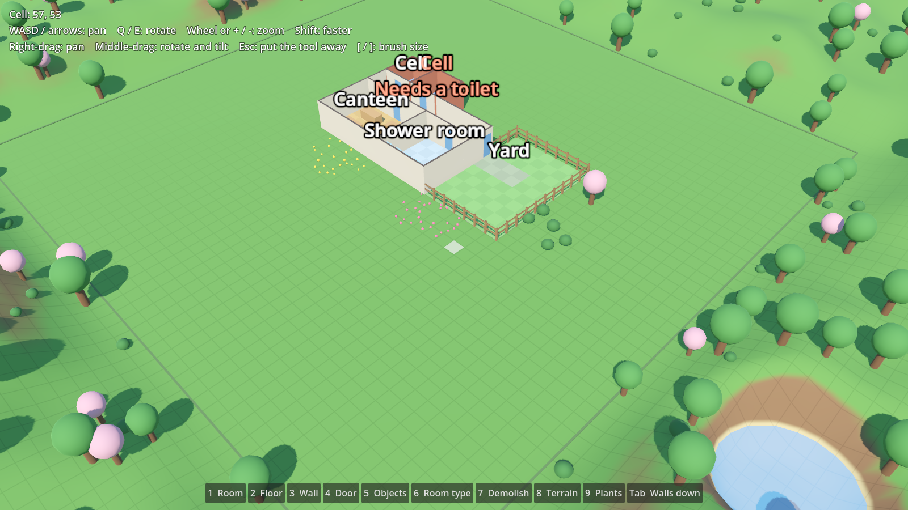

# Cosy Sims

A series of small, cute management sims that share one look and one set of
familiar mechanics. First up is a prison game, drawing on Prison Architect for
its systems, Parkitect for its camera and style, and The Sims / Software Inc.
for flexible building. Later games might include a hospital, an airport, a
school and a museum.



All art is placeholder for now. Built with [Godot 4.7](https://godotengine.org/).

## Getting started

1. Install Godot 4.7 (the standard build, not .NET).
2. Open Godot, choose **Import**, and pick this folder's `project.godot`.
3. Press **F5** to run. You start with a small sample prison you can fly
   around and build on.

### Controls

| Camera | |
| --- | --- |
| WASD or arrows | Pan |
| Q / E | Rotate |
| Mouse wheel or + / - | Zoom |
| Shift | Go faster |
| Right-drag | Pan |
| Middle-drag | Rotate and tilt |

| Building | |
| --- | --- |
| 1 Room | Drag to build a floor with walls all round |
| 2 Wall | Drag from corner to corner to build or restyle; snaps straight or to 45°, or pick Any angle (or hold Alt); hold Ctrl to remove |
| 3 Floor | Drag to lay or restyle floor on the side of any walls where you start; Shift-click floors or restyles the whole room; hold Ctrl to remove. Stairs: click the foot, move the way they climb, click short of the top for a landing, at the top to build; choose square or rounded landings |
| 4 Doors and windows | Pick a door, glass window or barred window, then click a wall; click it again to fill it in. A door can't join floors more than a step apart (see Door Steps below) |
| 5 Objects | Click to place; R turns by 45° and [ / ] change the step (90° down to 1°); hold F to pin it and turn it to face the mouse; hold Alt to place freely. Lifts link with a lift in the same spot upstairs |
| 6 Room type | Click a room to mark it as a cell, canteen and so on |
| 7 Paths | Straight: click each end. Curved: click the start, a bend and the end. Freehand: drag. Points snap to the middle of tiles (bends don't); hold Alt to swap that for one point, or turn Snap to grid off. Page Up / Down while placing builds stairs, a ramp or a bridge and raises its far end. Esc stops; Ctrl-click removes a path |
| 8 Plants | Hold to plant trees, bushes or flowers; hold Ctrl to clear them |
| 9 Terrain | Hold to raise, lower, flatten or smooth the ground; or add water to a hollow, or drain a pond |
| 0 Demolish | Click an object or wall to remove it, or drag to clear an area |
| [ / ] | Brush size, for terrain and plants |
| Tab | Loops through the wall views: Walls up; Cutaway (walls in front of rooms drop, following the camera round); Walls down; Roofs on (every level with its roofs, as from outside) |
| Esc | Put the tool away |
| F1 | The controls card |
| F3 | Debug view: rooms tinted and labelled, and details of the tile under the mouse. With no build tool (Esc), click a person, object, room or tile to inspect it: set a person's needs, send them somewhere, add or remove prisoners, pause everyone |

Hover any button in the build menu to see what it is. The room, floor and
wall tools let you pick a style from the picture tiles above the toolbar;
the Room tool shows each floor and wall pairing as a little cut-away room.
The level, wall view (Tab), controls card (F1) and debug view (F3) also have
buttons in the top-right corner. See [docs/ui.md](docs/ui.md) for how the UI
is put together. Fences, hedges, paving and lawn are outdoor styles: a room enclosed
by walls is indoors, but one bounded by a fence stays outdoors. Rooms are
worked out from the walls automatically. Once a room has a type, a label
floats over it saying what it still needs, such as a toilet. Labels that
would overlap on screen are hidden, keeping the ones about problems. A
door whose floors have drifted too far apart gets a label saying nobody
can use it.

You can only build, sculpt and plant inside the land you own, which is
marked by a low kerb. Building a room or floor flattens the ground under it
and clears any plants, and the ground under buildings can't be sculpted.
To make a pond, dig a hollow and click it with **Add water**. The
water rises to the lowest point of the rim, and moves when you dig deeper
or cut through the rim. Water stays off floors.

Paths and roads are curves, not tiles, though their ends snap to the
middle of tiles. Ends also snap to other paths (making a junction) and to
outside doors, and a path crossing another makes a junction with smooth
corners; paths can't run along or over each other. A path follows the
ground; stairs, ramps and bridges are your choice with Page Up and Page
Down while placing. Paths stay on your own land and off floors, and
building over a path removes it.

Each floor remembers its own height. New floor lines up with any floor
next to it, or else with the average height of the ground under it
(rounded to a quarter of a metre). The ground is fitted underneath so it
never shows through, and eased into a gentle bank round the building.
Higher floors stand on foundations. Upstairs and in basements, a grid
shows at that floor's height.

Indoor rooms get flat roofs at the top of their walls, wherever there is
no floor above. You see them when you go up a floor, or with Tab's Roofs
on view.

Split levels (floors nudged up or down within a storey, with ramps
between them) are switched off for now. Tick **Split Levels** on the Main
node in Godot's inspector to bring back the floor tool's Raise, Lower and
Ramp modes. Likewise, tick **Door Steps** to let a door join floors up to
a metre apart, with a few steps built on the low side; with it off, such
doors are refused.

Prisoners walk the build: through doors, up stairs and lifts, along paths
and over bridges. They get sleepy, hungry and grubby, and head off to a
free bed, table or shower when they need one; otherwise they wander.
Press F3 and click someone to see what they're up to.

### Sample prisons

Pick a sample with **Sample** on the Main node, or press F3 and choose one
at the bottom of the inspector panel. Each one tests a different part of
how prisoners find their way:

| Sample | What it tests |
| --- | --- |
| Starter block | Doors, a corridor and a fenced yard on flat ground |
| Two storeys | Cells upstairs, canteen and showers downstairs, joined by stairs and a lift |
| Hillside | Terraces too steep to climb, joined only by path stairs and a long ramp |
| Island | Cells on an island in a moat, with one bridge |
| Long way round | A corridor that doubles back, and showers behind an angled wall with a door |
| Basement | Canteen and showers in the basement, down stairs with a landing |
| Crowded canteen | 24 prisoners, 16 beds, two tables and two showers |
| Locked out | Showers with no door, and a raised canteen that needs Door Steps |

See [docs/design/building.md](docs/design/building.md) for the design
decisions behind all this.

## Layout

| Path | What |
| --- | --- |
| `core/` | Parts every game will share: camera, grid, input, building, terrain, paths, people. Kept free of prison-specific code. |
| `games/prison/` | The prison game. Anything specific to prisons lives here. |
| `tests/` | Headless checks (see below). |
| `tools/` | Developer helpers, such as the screenshot script. |
| `docs/` | The plan, and design notes in `docs/design/`. |

The rule of thumb: build things in `games/prison/` first, and move them into
`core/` once they work and we can see what is genuinely generic. See
[docs/plan.md](docs/plan.md).

## Checks

```sh
godot --headless --import --path .          # once, to build the class cache
godot --headless --path . -s res://tests/test_runner.gd
```

To save a screenshot of the main scene (needs a display, not `--headless`;
on a machine without a GPU, `xvfb-run` with Mesa's lavapipe Vulkan driver
works):

```sh
godot --path . -s res://tools/screenshot.gd -- screenshot.png
```
